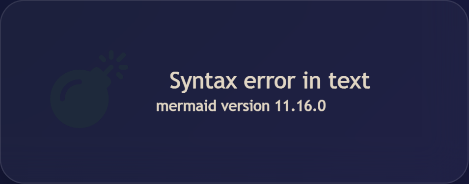
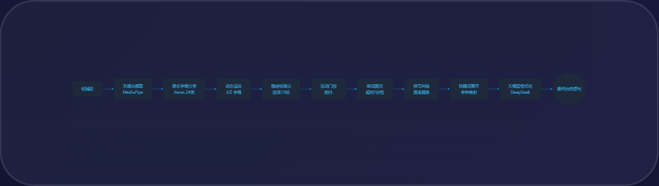

# ✋ ASL Pro Studio — 美式手语（ASL）指拼识别与翻译系统

一个基于 **摄像头实时手势识别** 的美式手语（American Sign Language, ASL）翻译系统：
通过 **指拼（Fingerspelling）** 识别，把聋人打出的字母手势实时翻译成英文单词和句子。

- 🧤 ASL 24 个静态字母（A–Y 中除 J 外，J 与 Z 为动态手势）+ **J / Z 动态手势**实时识别
- 🔤 逐字母拼词 → 停顿自动断词 → **拼写纠错** → **LLM 智能整理成通顺句子**
- 🎭 人脸认证登录（注册 / 登录 / 活体检测），每个用户可绑定**快捷键短语**
- 🌐 单页 Web 前端，WebSocket 实时推流，支持局域网多人同时访问（教室演示场景）

> 本仓库为课程项目源码，README 按完整复现流程编写，按步骤操作即可在 Windows / Linux 上运行。

## ✨ Features

- **ASL 指拼识别**：MediaPipe 手部 21 关键点 → 归一化特征 → Keras 分类模型
- **动态手势 J / Z**：轨迹识别（J 形弧线 / Z 形折线），45 帧滑动窗口
- **防抖稳定机制**：连续 15 帧投票一致才提交字母，抑制手部抖动
- **混淆字母修正**：A/T/S、C/E/O、K/V/U 等易混字母对的先验约束
- **单词拼写纠错**：pyspellchecker 自动纠错，拼词更准确
- **LLM 翻译**：可选接入 DeepSeek 大模型，把零散单词整理为通顺英文句子（**需配置 `DEEPSEEK_API_KEY`**，无 Key 时此功能不可用）
- **人脸认证**：DeepFace 人脸注册 / 登录 / 深度活体检测，多用户账户（**依赖 Orbbec 深度相机**，无 Orbbec 时人脸功能不可用）
- **快捷键系统**：每个用户可自定义"比一个字母 → 输出整句短语"的快捷表达
- **实时可视化**：浏览器端 21 关键点骨架渲染、置信度进度条、词/句流式展示
- **距离提示**：手离脸过近 / 过远时实时警告，保证识别质量
- **局域网部署**：`start.bat` 一键启动，教室同学手机 / 电脑浏览器即可访问

## 📸 系统架构

| 系统架构 | 识别流水线 |
|---------|-----------|
|  |  |

## 🛠️ Technologies Used

### 硬件
- **摄像头**：普通 USB 摄像头即可（默认，无需额外硬件）；如连接 Orbbec Femto RGB-D 深度相机并设置 `ENABLE_ORBBEC=1`，可额外启用深度人脸活体检测
- 一台可运行 Python 的电脑（建议 8GB+ 内存，GPU 可选）

### 软件
- **Python 3.10+** — 主开发语言
- **FastAPI + Uvicorn + WebSockets** — 后端服务与实时推流
- **MediaPipe HandLandmarker** — 手部 21 关键点检测（`models/hand_landmarker.task`）
- **TensorFlow / Keras** — ASL 字母分类模型（`models/model5.keras`）
- **OpenCV / NumPy** — 图像处理与特征计算
- **pyspellchecker** — 英文拼写纠错
- **DeepFace + scipy** — 人脸特征提取、认证与活体检测
- **DeepSeek LLM API**（OpenAI SDK）— 句子智能整理（可选，不填 Key 也可运行）

## 🚀 Getting Started（快速复现）

### 📋 环境要求

| 依赖 | 说明 |
|------|------|
| Windows 10/11 或 Linux | 已测试环境 |
| Python 3.10 ~ 3.12 | 建议 3.10 / 3.11（TensorFlow 兼容性最好） |
| 摄像头 | 普通 USB 摄像头即可（默认）；Orbbec Femto 可选（`ENABLE_ORBBEC=1` 启用深度活体检测） |
| DeepSeek API Key（可选） | 需要 LLM 翻译时配置；无 Key 时无法进行"单词 → 句子"联想翻译 |

> 💡 最低要求：只需一台带普通 USB 摄像头的电脑即可运行核心识别功能（指拼识别 / 拼词纠错 / 快捷键），无需 Orbbec 相机或 API Key。

> ⚠️ 功能限制：
>
> | 未满足的条件 | 受影响的功能 | 说明 |
> |------|------|------|
> | 未连接 Orbbec 深度相机 | **人脸识别（活体检测）** | 人脸认证依赖深度相机做活体检测（防照片/视频攻击）。无 Orbbec 相机时，**人脸注册 / 登录功能不可用**，活体检测步骤会被跳过 |
> | 未配置 DeepSeek API Key | **单词 → 句子的联想翻译** | LLM 翻译依赖 API Key。无 Key 时，系统只能输出你拼出的单词原文，**无法把零散单词整理成通顺的英文句子** |

> ⚠️ 项目使用 Keras 3 + TensorFlow 2.x，安装依赖约需 2~4 GB 磁盘空间。

### 🔧 第一步：进入项目文件夹并创建虚拟环境

```bash
# 本文件夹即为完整源码（无需 git clone），直接进入项目根目录
cd ASL-Recognition

# 创建虚拟环境（Windows）
python -m venv venv
venv\Scripts\activate

# 创建虚拟环境（Linux / macOS）
# python3 -m venv venv
# source venv/bin/activate

# 安装依赖
pip install -r requirements.txt
```

### ⚙️ 第二步：配置环境变量（可选）

设置系统环境变量（或 PowerShell 临时设置）：

```bash
# LLM 翻译功能（DeepSeek）；不配置则跳过 LLM 翻译，其余功能正常
DEEPSEEK_API_KEY=sk-xxxxxxxxxxxxxxxx
# 可选：自定义 API 地址（默认 https://api.deepseek.com）
DEEPSEEK_BASE_URL=https://api.deepseek.com
# 可选：连接了 Orbbec Femto 深度相机时设为 1，启用 RGB-D 深度与活体检测
ENABLE_ORBBEC=1
```

Windows PowerShell 设置示例：

```powershell
$env:DEEPSEEK_API_KEY = "sk-xxxxxxxxxxxxxxxx"
```

### ▶️ 第三步：启动

**方式一：一键启动（Windows）**

```bat
start.bat
```

**方式二：手动启动**

```bash
venv\Scripts\python -m uvicorn backend.main:app --host 0.0.0.0 --port 8765
```

### 📱 第四步：打开浏览器

- 本机访问：**http://127.0.0.1:8765**
- 局域网访问：手机 / 其他电脑打开 `http://<你的局域网IP>:8765`（启动时终端会打印）

界面操作流程：

1. 打开页面 → 授权摄像头权限
2. （可选）输入用户名 + 人脸注册 / 登录，启用个人快捷键
3. 在摄像头前比出 ASL 字母手势 → 系统实时识别并拼词（页面顶部有 A-Z 字母表参考图）
4. 拼完一个词后停顿 → 自动提交单词，进行拼写纠错
5. J / Z：在镜头前比划动态字母轨迹（J 形弧线 / Z 形折线）
6. 比出你绑定快捷键的字母 → 直接输出整句短语

## 📂 Project Structure

```
ASL-Recognition/
│
├── backend/                      # FastAPI 后端
│   ├── main.py                   # 主服务：WebSocket 推流 / 识别状态机 / 纠错与 LLM 翻译
│   ├── camera_manager.py         # 相机管理（默认 OpenCV；ENABLE_ORBBEC=1 时启用 Orbbec RGB-D）
│   ├── face_auth.py              # 人脸注册 / 登录 / 深度活体检测
│   ├── shortcuts_manager.py      # 用户快捷键短语系统
│   ├── pipelines/
│   │   ├── __init__.py           # BasePipeline 抽象
│   │   └── hand_asl.py           # ASL 指拼识别流水线（MediaPipe + Keras 模型）
│   └── shortcuts.json            # 快捷键短语配置（示例数据）
│
├── frontend/                     # 前端（单页应用，无需构建）
│   ├── index.html                # 主界面：视频流 / 关键点渲染 / 词句面板 / 字母表
│   └── letters/                  # 26 个字母示意图（A-Z）
│
├── models/                       # 模型文件
│   ├── hand_landmarker.task      # MediaPipe 手部关键点模型（Google 官方）
│   └── model5.keras              # ASL 字母分类模型（训练权重）
│
├── scripts/                      # 开发辅助脚本（课程报告 / PPT 生成等）
├── docs/                         # 文档与架构图
├── requirements.txt              # Python 依赖
├── start.bat                     # Windows 一键启动
└── README.md
```

## 🔍 How It Works

### 1. ASL 指拼识别流水线

```
摄像头 RGB 帧
   │
   ▼
MediaPipe HandLandmarker ──► 21 个手部关键点 (x, y, z)
   │
   ▼
坐标归一化（去均值 + 缩放到单位包围盒）
   │
   ▼
Keras 分类模型 (model5.keras) ──► 字母预测 + 置信度
   │
   ▼
稳定帧投票（连续 15 帧一致才提交，抑制抖动）
   │
   ▼
混淆字母修正（A/T/S、C/E/O、K/V/U 等）
   │
   ▼
拼词 → 停顿 → 拼写纠错（pyspellchecker）→（可选）LLM 翻译
```

### 2. J / Z 动态手势

- 检测手部运动轨迹：**J** 为弧形下划 + 上钩，**Z** 为三边折线
- 45 帧滑动窗口积累轨迹点 + 冷却帧防止误触发
- 静态字母与动态手势使用同一套关键点流，互不冲突

### 3. 单词与句子合成

- 拼完一个字母停顿后提交，进入词缓冲区
- 词超时（90 帧）自动断词 → 交给拼写纠错
- 句子 8 秒无新词自动归档，交给 LLM 整理为通顺表达（如配置了 Key）

### 4. 实时通信

- 后端 `camera_manager` 采帧线程 → 识别 → `frame_queue` 队列 → WebSocket `/ws` 推送
- 前端 Canvas 绘制 21 关键点骨架 + 连接线，JSON 消息携带字母 / 置信度 / 词 / 句状态

## ⚙️ Customization

### 修改识别参数

`backend/main.py` 顶部：

```python
STABLE_FRAMES = 15      # 稳定帧数（越大越稳，但响应更慢）
RESET_GAP = 20          # 字母重置间隔
WORD_TIMEOUT = 90       # 单词超时（帧数）
MIN_CONFIDENCE = 0.80   # 最低置信度
SENTENCE_TIMEOUT = 8    # 句子超时（秒）
```

### 修改混淆字母对

`backend/main.py` 顶部的 `CONFUSABLES` 字典：按你的使用场景调整易混淆约束（如 A/T/S、C/E/O）。

### 自定义快捷键短语

`backend/shortcuts.json`：

```json
{
  "你的用户名": {
    "a": "Hello nice to meet you",
    "b": "it my honor to show here"
  }
}
```

注册人脸时用户名需保持一致。

### 更换 ASL 分类模型

将新的 `.keras` 模型放入 `models/`，修改 `backend/pipelines/hand_asl.py`：

```python
model_path = os.path.join(SIGN_PATH, "model5.keras")  # 改为你的模型文件名
```

## 🐛 Troubleshooting

### 启动报错 `No module named ...`

```bash
pip install -r requirements.txt   # 确认依赖安装完整
```

TensorFlow 安装失败时，尝试 Python 3.10 / 3.11，或安装 CPU 版：`pip install tensorflow-cpu`。

### 摄像头打不开 / 黑屏

- 检查摄像头是否被其他软件（微信 / 腾讯会议）占用
- 浏览器地址栏点击摄像头权限，选择"允许"
- 系统**默认使用普通 USB 摄像头（OpenCV 模式）**，无需任何额外硬件
- 若设置过 `ENABLE_ORBBEC=1`：确认相机连接正常、`pyorbbecsdk` 已安装，失败时也会自动回退到 OpenCV

### 识别不准 / 字母总是错

- 保证手在画面中央、光线充足
- 关注页面上的距离提示，手不要离脸太近
- 提高 `STABLE_FRAMES` 让识别更稳；检查 `main.py` 的 `CONFUSABLES` 是否可针对你的场景调整
- J / Z 识别：比划动作要连贯、幅度大一些

### 手机访问不了局域网地址

- 确认手机与电脑在**同一 WiFi**
- Windows 防火墙放行 8765 端口（或允许 Python 通过防火墙）
- 优先使用启动时终端打印的 Network URL

### LLM 翻译不工作

- 检查 `DEEPSEEK_API_KEY` 是否配置正确（PowerShell 中 `echo $env:DEEPSEEK_API_KEY` 验证）
- **无 API Key 时无法进行"单词 → 句子"的联想翻译**，系统只会输出拼出的单词原文；这是预期行为，不影响指拼识别

### 人脸注册 / 登录不工作

- **人脸认证（含活体检测）依赖 Orbbec 深度相机**：未连接 Orbbec（或未设置 `ENABLE_ORBBEC=1`）时，人脸注册 / 登录功能不可用，系统会跳过活体检测步骤
- 使用人脸功能需要：连接 Orbbec Femto 相机 → 设置 `ENABLE_ORBBEC=1` → 重启服务

## 🧠 Lessons Learned

- **关键点归一化**：21 个手部关键点先去均值（掌心）再缩放到单位包围盒，模型才能对不同的手型和距离泛化
- **稳定帧投票**：单帧预测抖动大，连续帧投票 + 冷却间隔是实时的关键
- **混淆字母对**：A/T/S、C/E/O 等在 2D 视角下高度相似，需要先验约束修正
- **WebSocket 推流**：线程采集 + 队列缓冲 + 异步推送，避免阻塞主循环
- **深度相机价值**：RGB-D 的深度信息可显著提升活体检测（人脸认证防照片攻击）

## 🔮 Future Enhancements

- [ ] 增加完整 ASL 词汇（非指拼）识别
- [ ] 提供模型训练脚本，支持自定义数据集微调
- [ ] 手语 → 语音播放（TTS）
- [ ] 多用户并发会话 / 多相机支持
- [ ] Docker 一键部署
- [ ] 移动端 PWA 适配

## 📄 License

本项目采用 **MIT License** —— 详见 [LICENSE](LICENSE) 文件。

> 注意：`models/hand_landmarker.task` 来自 Google MediaPipe 官方（Apache 2.0）；
> `models/model5.keras` 训练权重来自开源项目 [kevinjosethomas/sign-language-translation](https://github.com/kevinjosethomas/sign-language-translation)，仅用于学习研究。

## 🙏 Acknowledgements

1. [Google MediaPipe](https://ai.google.dev/edge/mediapipe) — 手部关键点检测模型
2. [kevinjosethomas/sign-language-translation](https://github.com/kevinjosethomas/sign-language-translation) — ASL 分类模型与训练思路
3. [DeepSeek](https://platform.deepseek.com/) — LLM 翻译服务
4. [FastAPI](https://fastapi.tiangolo.com/) / [TensorFlow](https://www.tensorflow.org/) / [OpenCV](https://opencv.org/) — 核心依赖框架
5. Orbbec — RGB-D 深度相机 SDK

