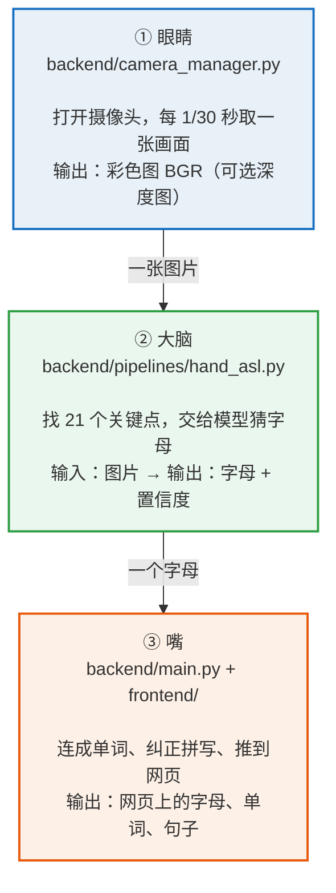

# ASL 手语识别与翻译系统 · 零基础复现手册

> **深度相机**：Orbbec Gemini 336L
> **环境**：Python 3.12 · Windows 10 / 11 · Anaconda
> **源码仓库**：https://github.com/07xzh/scnu_light_chasing_project
>
> **项目演示视频下载**：https://github.com/07xzh/scnu_light_chasing_project/releases/download/v1.0/ASL.mp4
>
> **从一行命令都不会，到完整跑通。**

---

## 阅读指南

假设你**从来没有配过 Python 环境**，也不知道什么是虚拟环境、依赖、命令行。所有内容按"照着做就能成"的顺序编写，每一处都标了**成功标志**和**失败怎么办**。
**获取源码**

> 完整源码在 GitHub：
> https://github.com/07xzh/scnu_light_chasing_project
>
> 克隆命令：`git clone https://github.com/07xzh/scnu_light_chasing_project.git`
>
> 本手册所有命令中的项目路径，请替换成你克隆后的实际目录。

### 你会得到什么

| 阶段        | 耗时       | 成果                   |
| --------- | -------- | -------------------- |
| 装环境 + 装依赖 | 30–50 分钟 | 一个能跑本项目的独立 Python 环境 |
| 第一次启动     | 5 分钟     | 浏览器里出现网页与摄像头画面       |
| 比出手语字母    | 5 分钟     | 网页上出现识别到的字母          |
| 接入深度相机    | 30–60 分钟 | 人脸活体检测 + 真实距离测量      |

**零基础必读：三个需要注意的点**

**1. 报错不是失败，是信息。**
看到红字先别慌，也别乱删东西，去对照表里找。
**2. 不要用系统自带的 Python。**
你的电脑上可能装着 Python 3.13 / 3.14，而本项目的深度学习库只提供 3.12 的预编译版本。
**3. 命令必须一行一行粘。**
把两三行命令一起粘进 CMD，会被合并成一条，报出像"指定不存在的设备"这种与原因完全无关的错误

**关于深度相机型号**
本手册记录的实测复现使用 **Orbbec Gemini 336L**，与Orbbec其他型号的相机都同属于 Orbbec RGB-D 生态，采集逻辑一致，差别集中在 SDK 版本与设备驱动上。若你手上是其他 Orbbec 型号，流程基本相同。

---

## 一、这个项目是什么

一句话：**把摄像头拍到的美式手语（ASL）指拼动作，实时识别成英文字母，再拼成单词和句子，显示在网页上。**

### 1.1 六个核心能力

| 能力         | 说明                                 |
| ---------- | ---------------------------------- |
| 静态字母识别     | 24 个字母（A–Y，不含 J / Z）               |
| J / Z 动态手势 | 靠"画轨迹"判断，需要慢一点、幅度大一点               |
| 拼词与拼写纠错    | 停顿自动断词，用词典 + 易混字母表纠错               |
| LLM 句子整理   | 可选。配置 DeepSeek API Key 后整理成自然句子    |
| 人脸登录与活体检测  | 需深度相机才能启用完整活体判断                    |
| 网页实时展示     | FastAPI + WebSocket，手机也能看（不用手机摄像头） |

### 1.2 它是三层结构

把项目想成"眼睛 → 大脑 → 嘴"。数据是一条直线流下去：图片 → 字母 → 单词。

**① 眼睛 · `backend/camera_manager.py`**
打开摄像头，每隔约 1/30 秒取一张画面。
输出：一张彩色图（BGR），可选一张深度图。

**② 大脑 · `backend/pipelines/hand_asl.py`**
在图上找到 21 个手指关节点，再交给模型猜字母。
输入：图片 → 输出：字母 + 置信度（如 `A / 0.96`）。

**③ 嘴 · `backend/main.py` + `frontend/`**
把字母连成单词、纠正拼写，推到网页上给用户看。
输出：网页里的字母、单词、句子。


**记忆口诀**：眼睛负责看、大脑负责认、嘴负责说 —— 三个文件，一条流水线。任何一层坏了，后面都看不到结果，所以排错时先看"哪一层没跑起来"，再管具体的代码。

### 1.3 目录结构

```text
ASL-Recognition/
├── backend/
│   ├── main.py                << 总调度：相机/WebSocket/识别循环
│   ├── camera_manager.py      << 相机管理（普通摄像头 / Orbbec）
│   ├── face_auth.py           << 人脸登录、活体检测、距离判断
│   ├── shortcuts_manager.py   << 快捷短语
│   └── pipelines/
│       └── hand_asl.py        << 关键点 + 字母分类
├── frontend/
│   ├── index.html             << 网页本体（后端托管，无需 Node）
│   └── letters/               << 字母示意图
├── models/
│   ├── hand_landmarker.task   << 手部检测模型（已提供）
│   └── model5.keras           << 字母分类模型（已提供）
├── requirements.txt           << 依赖清单（13 个库）
└── start.bat                  << 原始一键启动（本手册不用）
```

**注意！：两个模型都已经在项目里了。**
你不需要训练任何东西，也不需要下载模型文件。项目复制下来就能用。

---

## 二、准备工作

### 2.1 硬件清单

- 一台 Windows 10 / 11 电脑，内存 8 GB 以上（推荐 16 GB）
- 一个普通 USB 摄像头，或笔记本自带摄像头（先用它跑通主流程）
- Orbbec Gemini 336L 深度相机（可选，第六章再接入）
- USB-C **数据线**（不是充电线，很多线只有供电针脚）
- 磁盘空闲空间 10 GB 以上

### 2.2 软件清单

- Anaconda（提供 conda 与 Anaconda Prompt）
- Chrome 或 Edge 浏览器
- 项目代码完整放在固定目录，例如 `D:ASL-Recognition`
  **强烈建议：不要把项目长期放在 U 盘 / 移动硬盘上运行**
  实测中曾出现运行中途移动硬盘接触不良掉盘，网页立刻变成 `Internal Server Error`，终端报 `FileNotFoundError: frontend\index.html` —— 看似代码出错，实际是整个盘消失了。建议把项目复制到本地硬盘运行，U 盘只作备份。

### 2.3 开始前的三件事

1. 关掉所有可能占用摄像头的软件：微信、QQ、腾讯会议、相机 App
2. 确认项目目录里能看到 `backend`、`frontend`、`models`、`requirements.txt`
3. 记住一句话：**本手册所有命令都在 Anaconda Prompt 里敲**

---

## 三、搭建独立环境

### 3.1 为什么必须用独立环境

| 理由    | 说明                                                                          |
| ----- | --------------------------------------------------------------------------- |
| 版本硬约束 | TensorFlow 只对特定 Python 版本发布预编译包。文件名里的 `cp312` 表示"给 3.12 编译的机器码"，版本对不上根本加载不了 |
| 互不干扰  | A 项目要 numpy 1.x，B 项目要 2.x，装同一地方会互相覆盖                                        |
| 可随时删除 | 环境坏了，一条命令删掉重建，不影响系统 Python                                                  |

**顺带说清三个词**：只有"依赖包"是装出来的，环境和路径不是装出来的。

| 概念 | 本质 | 为什么必须 |
|---|---|---|
| 环境 | 一个装着独立 Python 的目录 | 3.14 装不上 TensorFlow 正式版（预编译只到 3.12） |
| 依赖包 | 13 个库，装进环境里 | 代码 import 的就是它们，少一个就报 `ModuleNotFoundError` |
| 路径 | 找不到东西的根源（不是能装的物件） | 工作目录 / PATH / sys.path 任一错位，前两者都白做 |

### 3.2 打开正确的窗口

开始菜单搜索 **Anaconda Prompt** 并打开（不要用"命令提示符"，也不要用 PowerShell）。窗口打开后长这样：

```text
(base) C:\Users\你的用户名>
```

`(base)` 表示当前在 conda 的基础环境。

### 3.3 创建环境

**步骤 1　执行创建命令**

```cmd
conda create -n asl python=3.12 -y
```

含义：创建名为 `asl` 的环境、装 Python 3.12、`-y` 表示所有询问自动同意。约 1–3 分钟。

正常输出（片段）：

```text
Collecting package metadata (repodata.json): done
Solving environment: done
  environment location: D:\Anaconda\envs\asl
Preparing transaction: done
Verifying transaction: done
Executing transaction: done
#
# To activate this environment, use
#     $ conda activate asl
```

**成功标志**：提示符重新出现并可以继续输入。
**如果报 Terms of Service / ToS 错误**
先执行下面两条，再重新执行创建命令：

> ```cmd
> conda tos accept --override-channels --channel https://repo.anaconda.com/pkgs/main
> conda tos accept --override-channels --channel https://repo.anaconda.com/pkgs/r
> ```

**如果报 PackagesNotFoundError 或长时间卡在 Solving**
换 conda-forge 源：`conda create -n asl -c conda-forge python=3.12 -y`

### 3.4 激活并验证

**步骤 2　激活**

```cmd
conda activate asl
```

**成功标志**：提示符从 `(base)` 变成 `(asl)`。

**步骤 3　确认版本与路径**

```cmd
python -V
python -c "import sys; print(sys.executable)"
```

必须**同时**满足：打印 `Python 3.12.x`；路径指向 `...\Anaconda\envs\asl\python.exe`。如果打印 3.13 / 3.14 或路径不对，**不要继续**，重新激活。
**

为什么这一步这么重要？？？
此后这个窗口里所有 `python`、`pip` 都指向这个环境。

---

## 四、安装依赖

### 4.1 进入项目目录

**步骤 4　切换目录（注意 /d）**

```cmd
cd /d D:\Femto_mega\ASL-Recognition
dir requirements.txt
```

**为什么有 `/d`**：CMD 里的 `cd` 默认只能在本盘内切换。从 C 盘切到 D 盘必须加 `/d`，否则它什么都不做也不报错，然后你会在错误的目录里执行后续命令。

**成功标志**：提示符变成 `(asl) D:\ASL-Recognition>`，且 `dir` 能列出 `requirements.txt`（约 580 字节）。

### 4.2 执行安装

**步骤 5　安装 13 个依赖**

```cmd
python -m pip install -r requirements.txt
```

为什么写 `python -m pip` 而不是直接 `pip`：前者保证用的是"当前这个 python"对应的 pip，多版本共存时直接敲 `pip` 可能装到别的 Python 里。

会刷几百行 `Collecting` / `Downloading`，解压后约 **2.4 GB**

```text
Successfully installed fastapi-0.162.0 keras-3.15.1 mediapipe-1.1.1 \
  numpy-2.5.4 opencv-python-5.0.0.93 tensorflow-2.21.0 uvicorn-0.54.0 ...
```

**安装过程中不要关窗口、不要按 Ctrl+C**
中途断开会留下"半装"状态，后续报错非常迷惑。真断了就执行 `python -m pip uninstall -y -r requirements.txt` 清干净再重来。

**网络太慢时的加速方法**
按 `Ctrl+C` 停掉，改用国内镜像：

> ```cmd
> python -m pip install -r requirements.txt -i https://mirrors.ustc.edu.cn/
> ```

### 4.3 安装后必须做的两件事

#### ① 修复已知缺失依赖

本项目使用的 `deepface 0.0.103` 漏声明了 `werkzeug`，但它内部又真的 import 了它。不装会直接崩：

```text
ModuleNotFoundError: No module named 'werkzeug'
```

修复只需一条：

```cmd
python -m pip install werkzeug
```

**如果之后又出现别的 No module named 'xxx'**
同一招处理：`python -m pip install xxx`。deepface 的依赖声明不完整，可能还会缺 flask 之类的包，属于库本身的问题，不是你的操作错。

#### ② 导入自检

```cmd
python -c "import tensorflow, keras, mediapipe, cv2, deepface, fastapi; print('deps ok')"
```

**成功标志**：打印 `deps ok`。首次 import tensorflow 需 20–60 秒，屏幕会先出现几行 TensorFlow 提示，正常。

---

## 五、第一次启动

### 5.1 启动命令

**步骤 6　启动服务**

```cmd
python -m uvicorn backend.main:app --host 0.0.0.0 --port 8765
```

七个部分各自含义：

| 片段                 | 含义                                                  |
| ------------------ | --------------------------------------------------- |
| `python`           | 用哪个解释器（由是否激活 asl 环境决定）                              |
| `-m uvicorn`       | 把 uvicorn 当模块运行，保证用当前环境里那个                          |
| `backend.main:app` | 导入字符串：模块路径 + 对象名（对应 `main.py` 里的 `app = FastAPI()`） |
| `--host 0.0.0.0`   | 监听所有网卡，局域网内手机也能访问                                   |
| `--port 8765`      | 端口号，同一时间只能被一个进程占用                                   |

### 5.2 启动日志逐行解读

```text
[CAMERA] 使用标准 OpenCV 摄像头采集模式...
INFO:     Started server process [5740]
INFO:     Waiting for application startup.
[INFO] Loading ASL model...
[ASL] GPU delegate failed: ValidatedGraphConfig Initialization failed.
INFO: Created TensorFlow Lite XNNPACK delegate for CPU.
[ASL] Hand landmarker loaded (CPU)
[ASL] Model loaded
[CAMERA THREAD] Background capture started.
[INFO] Server ready at http://localhost:8765
INFO:     Application startup complete.
INFO:     Uvicorn running on http://0.0.0.0:8765 (Press CTRL+C to quit)
```

| 日志                             | 含义                          |
| ------------------------------ | --------------------------- |
| `[CAMERA] 使用标准 OpenCV...`      | 没启用深度相机，走普通摄像头（正常）          |
| `[ASL] GPU delegate failed`    | 没有可用 GPU，自动退回 CPU 推理。 |
| `XNNPACK delegate for CPU`     | CPU 加速已启用，性能足够实时            |
| `[ASL] Model loaded`           | 两个模型都加载成功（关键）               |
| `[CAMERA THREAD] ... started`  | 摄像头真正打开了（关键）                |
| `Application startup complete` | 启动完成（关键）                    |

**注意！！：**
**第一次启动会"看起来卡住"**
这是因为加载 TensorFlow 和两个模型文件需要一定的时间。中途千万别按 Ctrl+C。

### 5.3 打开网页

浏览器（Chrome / Edge）打开：

```text
http://127.0.0.1:8765
```

**成功标志**：出现网页界面，并且能看到摄像头实时画面。

**手机访问**
电脑与手机连同一个 WiFi，用终端打印的局域网地址（形如 `http://192.168.1.8:8765`）。首次启动弹出的防火墙提示要选"允许专用网络"。**注意**：手机看到的是电脑上那台相机的画面，手机自己的摄像头不会被使用。

### 5.4 第一次识别：为什么"要停住不动"

把手放进画面，应先看到彩色手部骨架（21 个关键点连线），然后比出字母 **A**（握拳，拇指贴在食指侧面），**保持不动约半秒**，网页上就会出现字母 A。

| 参数（main.py）      | 值    | 作用                   |
| ---------------- | ---- | -------------------- |
| `STABLE_FRAMES`  | 15   | 连续 15 帧识别成同一字母，才真正提交 |
| `MIN_CONFIDENCE` | 0.80 | 置信度低于 0.8 直接丢弃       |
| `WORD_TIMEOUT`   | 90   | 停顿约 3 秒自动断词并纠错       |

**值得注意的是：**
**模型只认 24 个字母**
`ABCDEFGHIKLMNOPQRSTUVWXY` —— 没有 J 和 Z。这两个字母需要"画轨迹"，走的是另一套动态手势逻辑（见第八章）。

---

### 5.5 每次启动就这四行

熟悉之后，日常只需要下面四行，不用再翻前面的章节：

```cmd
conda activate asl
cd /d D:\Femto_mega\ASL-Recognition
set ENABLE_ORBBEC=1
python -m uvicorn backend.main:app --host 0.0.0.0 --port 8765
```

不用深度相机的话，把第三行 `set ENABLE_ORBBEC=1` 去掉即可。

### 5.6 uvicorn 到底是什么

它是一个 **ASGI 服务器**：负责监听端口、解析 HTTP / WebSocket 报文，把请求交给 FastAPI 应用，再把结果发回浏览器。

```text
浏览器 --TCP--> uvicorn（解析 HTTP/WS）--ASGI--> FastAPI(app) --> 你的代码
```

**FastAPI 自己不监听端口**，它只是被调用的函数集合。没有 uvicorn 这个"接线员"，业务员接不到电话。

### 5.7 需要给深度相机"烧录"程序吗

**不需要。** 烧录适用于"代码跑在设备里"的场景（单片机）。本项目里代码跑在**电脑**上，相机只是一个通过 USB 输出画面的外设。

代码真正碰相机的动作只有四个：打开、配置、取帧、关闭。全是"我发请求，相机照办，我收数据"。相机内部确实有固件，但那是厂商出厂烧好的，我们不碰。

### 5.8 代码是什么时候开始"生效"的

| 时刻 | 发生什么 |
|---|---|
| 写代码、存文件 | 无影响。硬盘上的 `.py` 与一张图片没有区别 |
| 装依赖 | 只是把工具摆上货架，不执行任何项目代码 |
| **敲下 uvicorn 命令并回车** | **进程启动 → import main.py → 相机被打开（这是起点）** |
| 按 Ctrl+C | 进程结束，相机与端口释放，作用归零；硬盘文件一个字节都没变 |

由此可以得出一个实践结论：**改了代码必须重启服务**。Python 不会热重载，替换了 `camera_manager.py` 却没重启，内存里跑的仍是旧代码。

## 六、接入深度相机 Gemini 336L

**先明确深度相机能带来什么**
它**不会提升手语识别效果**（识别只用彩色画面）。深度只用于两件事：① 人脸活体检测（真人脸有立体起伏，照片是平的）；② 真实距离测量（30–120 cm）。

### 6.1 硬件连接

- 用**原装 USB-C 数据线**连接
- 插**主板后置的 USB 3.0 接口**（蓝色或带 SS 标识），不要用前面板、不要经 USB Hub
- 运行本项目前**关闭 Orbbec Viewer**（相机是独占设备，同时只能被一个程序使用）

**Tips:**
先用官方 Orbbec Viewer 验证硬件
能正常输出 Color 流、Depth 流且两者对齐正常，再进行下一步。Viewer 里都出不来图，代码里一定也读不到。

### 6.2 安装 Orbbec Python SDK

**步骤 7　安装 SDK**

```cmd
python -m pip install --upgrade pyorbbecsdk2
```

会装上 `pyorbbecsdk2` 的预编译轮子（约 18 MB，免编译），以及 `av`、`pygame`、`pynput` 三个依赖。

**成功标志**：

```text
Successfully installed av-12.3.0 pygame-2.6.1 pynput-1.8.2 pyorbbecsdk2-2.1.2
```

**包名与导入名不一致，这是最容易搞错的地方**
pip 安装用的**包名**是 `pyorbbecsdk2`，但代码里 **import 的名字**是 `pyorbbecsdk`。验证命令要写：

> ```cmd
> python -c "import pyorbbecsdk; print('Orbbec SDK import ok')"
> ```

### 6.3 确认能认到设备

**步骤 8　设备自检**

```cmd
python -c "from pyorbbecsdk import Context; c=Context(); d=c.query_devices(); print('设备数量:', d.get_count())"
```

**成功标志**：打印 `设备数量: 1`（或更多）。

**打印 0**：按顺序排查 —— 换后置 USB 3.0 口 → 换原装数据线 → 关掉占用相机的程序 → 执行下面的驱动配置。

**设备数量为 0 时的驱动配置（Windows）**
先查出 SDK 安装位置：

> ```cmd
> python -c "import pyorbbecsdk, os; print(os.path.dirname(pyorbbecsdk.__file__))"
> ```
>
> 复制打印出的路径，再执行（会请求管理员权限）：
>
> ```cmd
> python "<上一步打印的路径>\shared\setup_env.py"
> ```
>
> 如果提示该脚本不存在，说明当前版本无需额外配置，问题在线材或 USB 接口上。

### 6.4 为什么必须替换相机模块

**关键问题在这一行：**

```text
config.enable_stream(self.ob.OBSensorType.COLOR_SENSOR)   # 参数类型错误
```

真实 SDK 要求传入的是**流配置对象**（stream profile），而不是传感器类型枚举。这行会抛 `TypeError`，然后被外层的 `except Exception` 吞掉，程序**静默退回普通摄像头** —— 现象就是"装了 SDK 却完全没用上"，而且没有任何明显报错。

正确写法是三步走：

```python
color_profile = pipeline.get_stream_profile_list(OBSensorType.COLOR_SENSOR).get_default_video_stream_profile()
config.enable_stream(color_profile)

depth_profile = pipeline.get_stream_profile_list(OBSensorType.DEPTH_SENSOR).get_default_video_stream_profile()
config.enable_stream(depth_profile)

config.set_align_mode(OBAlignMode.ALIGN_D2C_HW_MODE)   # 深度对齐到彩色
pipeline.start(config)
```

为什么要"对齐"：彩色与深度是两个不同镜头拍的。手部坐标是在**彩色图**上算出来的，要拿这个坐标去深度图里查距离，必须让两张图像素一一对应，这就是 D2C（Depth to Color）对齐。

### 6.5 执行替换

**步骤 9　备份并替换**

```cmd
cd /d D:\Femto_mega\ASL-Recognition\backend
ren camera_manager.py camera_manager.py.bak
copy "<修正版路径>\camera_manager_patched.py" camera_manager.py
dir camera_manager.py*
```

**成功标志**：看到两个文件

```text
camera_manager.py         8,258 字节   << 新的（不是 4,772 就说明没替换成功）
camera_manager.py.bak     4,772 字节   << 原版备份
```

**替换时最常见的两个失误**
① 两三条命令一起粘，被合并成一条，报 `指定不存在的设备` / `已复制 0 个文件`。
② 在错误的目录下执行。**做法：一次只粘一条，每条回车后看提示符再继续。**

### 6.6 启用并启动

**步骤 10　开启深度相机开关**

```cmd
cd /d D:\Femto_mega\ASL-Recognition
set ENABLE_ORBBEC=1
echo %ENABLE_ORBBEC%
python -m uvicorn backend.main:app --host 0.0.0.0 --port 8765
```

`echo` 那行应打印 `1`。不是 1 说明设置没生效，重敲一次。

注意：`set` 只对当前窗口有效，且必须在启动命令**之前**执行。关掉窗口就失效了。

### 6.7 验证深度真的在用了

**启动日志**应该出现：

```text
[CAMERA] 已加载 Orbbec SDK 模块: pyorbbecsdk
[CAMERA] 检测到 Orbbec SDK 库，尝试初始化硬件深度相机...
[CAMERA] 深度对齐模式: ALIGN_D2C_HW_MODE
[CAMERA] Orbbec RGB-D hardware camera started successfully! color=(1280, 720) depth=(848, 480)
```

**运行时日志**（距离提示）应出现 `mode=ORBBEC`：

```text
[DIST] 42cm  mode=ORBBEC  warn=None
```

如果显示 `mode=OPENCV`，说明还在用"手掌像素大小估算"，深度没生效。

做人脸认证时，终端会出现这两行（只有拿到深度才会打印）：

```text
[FACE] Depth STD: 12.3mm  (threshold=5.0)
[FACE-DIST] RGB: 1280x720  Depth: 848x480  face_box=(...)
```

反之，如果看到下面这句，说明活体检测被跳过了：

```text
[FACE] No depth frame - liveness bypassed (insecure_fallback)
```

### 6.8 失败时如何回滚

```cmd
cd /d D:\Femto_mega\ASL-Recognition\backend
copy /Y camera_manager.py.bak camera_manager.py
```

或者更简单：**不设置 `ENABLE_ORBBEC`**，程序会自动使用普通摄像头。修正版代码有完整异常捕获，深度初始化失败会自动降级，**不会导致服务起不来**。

---

## 七、常见故障

按"你看到的报错"查表。找不到对应项时，把**完整报错前后几行**贴出来再求助。

**卡住时先敲下面几条，能快速分清是"没装"还是"找不到"：**

```cmd
where python                    :: 现在用的是哪个解释器
python -m pip -V                :: pip 属于哪个环境
conda env list                  :: 有哪些环境
python -m pip check             :: 检查依赖冲突
netstat -ano | findstr 8765     :: 端口是否在监听
```

### 7.1 环境与安装阶段

| 现象                                              | 原因与修法                                                  |
| ----------------------------------------------- | ------------------------------------------------------ |
| `conda 不是内部或外部命令`                               | 用错窗口。改用 Anaconda Prompt                                |
| `CommandNotFoundError: shell not configured`    | PowerShell 里先 `conda init powershell`，再关窗口重开           |
| `Could not open requirements file`              | 当前目录不对。先 `cd /d 项目路径`，确认提示符盘符                          |
| `No matching distribution found for tensorflow` | 当前 python 不是 3.12。`conda activate asl` 后核对 `python -V` |
| 装了依赖但启动说找不到包                                    | 装到了别的 Python。用 `python -m pip -V` 核对归属                 |

### 7.2 启动阶段

| 现象                                        | 原因与修法                                   |
| ----------------------------------------- | --------------------------------------- |
| `No module named 'werkzeug'`              | 已知缺失依赖：`python -m pip install werkzeug` |
| `No module named 'pipelines'`             | 没在项目根目录启动。回到项目根再执行 uvicorn              |
| `[Errno 10048] ... bind on address`       | 端口被占。换 `--port 8766` 或关掉旧进程             |
| 启动后终端很久没反应                                | 正常，加载模型需一定的时间。不要按 Ctrl+C                |
| 大量 `W0000 ... inference_feedback_manager` | TensorFlow 内部提示，无害，可忽略                  |

### 7.3 网页阶段

| 现象                                                        | 原因与修法                                    |
| --------------------------------------------------------- | ---------------------------------------- |
| `Internal Server Error` + `FileNotFoundError: index.html` | 项目所在磁盘掉了（U 盘常见）。插回后重启服务                  |
| 网页打开但画面全黑                                                 | 摄像头被其他软件占用，关掉微信/QQ/会议软件再启动               |
| 手机打不开页面                                                   | 防火墙拦截。防火墙提示选"允许专用网络"，确认 `--host 0.0.0.0` |
| 手在画面里但没有骨架                                                | 手太小或光线不足。整掌入画，距离 50–100 cm               |
| 有骨架但不出字母                                                  | 动作太快。比出来后保持不动约半秒（15 帧）                   |

### 7.4 深度相机阶段

| 现象                                                 | 原因与修法                                              |
| -------------------------------------------------- | -------------------------------------------------- |
| `No module named pyorbbecsdk2`                     | 导入名判断反了：导入用 `pyorbbecsdk`，包名才是 `pyorbbecsdk2`      |
| 设备数量为 0                                            | USB 2.0 口 / 充电线 / 驱动未装。换后置口 + 原装线 + `setup_env.py` |
| `enable_stream(): incompatible function arguments` | 仍是旧代码。确认已替换为修正版                                    |
| `AttributeError: HW_MODE`                          | 枚举名不匹配。修正版使用 `ALIGN_D2C_HW_MODE`                   |
| 日志出现 `falling back to OpenCV`                      | 深度初始化失败。看括号内错误原文；未替换最常见                            |
| 拉流超时 / 卡住                                          | 相机被 Orbbec Viewer 等程序占用，关掉后重试                      |
| 固件版本不匹配报错                                          | 用 Orbbec 官方固件升级工具（需管理员权限）                          |

---

## 八、可选功能与使用方法

### 8.1 静态字母（24 个）

可识别：`ABCDEFGHIKLMNOPQRSTUVWXY`。动作要慢，比出来后停住。

### 8.2 拼词与自动纠错

依次比出 **H → E → L → P**，然后**停顿约 3 秒**。系统自动断词并做两级纠错：先用 `pyspellchecker` 词典找候选词；失败则按"易混字母表"替换再试（A/T/S、C/E/O、M/N、K/V/U 等）。

### 8.3 J / Z 动态手势

| 字母  | 触发条件          | 动作             |
| --- | ------------- | -------------- |
| J   | 系统稳定识别出 **I** | 小指向外划出一个 J 形轨迹 |
| Z   | 系统稳定识别出 **D** | 食指横向画出 Z 形轨迹   |

动作要慢一点、幅度大一点。轨迹窗口只有 45 帧，指尖位移必须明显大于其他关键点位移（ratio 1.5），动作太小会被误判成 I 或 D。

### 8.4 DeepSeek 句子整理（可选）

```cmd
set DEEPSEEK_API_KEY=sk-你的key
set DEEPSEEK_BASE_URL=https://api.deepseek.com
```

不配置也能正常识别和拼词，只是少了"整理成自然英文句子"这一步。`main.py` 里是懒加载：只有检测到 API Key 才会创建客户端。

### 8.5 人脸登录与活体检测（需深度相机）

1. 在网页里完成人脸注册，数据存在 `backend/face_db/`
2. 首次使用会联网下载预训练权重到 `C:\Users\你的用户名\.deepface\weights`
3. 活体检测原理：统计人脸区域深度值标准差，照片和屏幕更接近平面，标准差过小会被拒绝
4. 距离要求 30–120 cm

---

---

## 演示视频

[▶ 点击播放完整演示（45.3 MB）](../videos/ASL.mp4)

<video src="../videos/ASL.mp4" controls width="720"></video>


