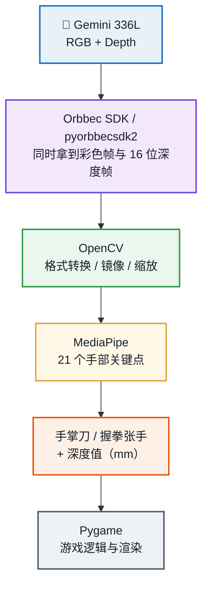

# 深度相机体感游戏 · Windows 复现教程

> **深度相机**：Orbbec Gemini 336L
> **环境**：Windows 10 / 11 · Python 3.12 · Anaconda
> **源码仓库**：https://github.com/07xzh/scnu_light_chasing_project
>
> 项目演示视频下载：
>
> 切水果：https://github.com/07xzh/scnu_light_chasing_project/releases/download/v1.0/FRUIT.mp4
>
> 搭积木：https://github.com/07xzh/scnu_light_chasing_project/releases/download/v1.0/GESTURE.mp4
>
> 从解压源码到两个游戏都能玩。

---

## 阅读指南

本次复现教程实现了：在 Windows 10/11 + Python 3.12 + Orbbec Gemini 336L 上做切水果和搭积木两项体感游戏。


**获取源码**
完整源码与补丁脚本：https://github.com/07xzh/scnu_light_chasing_proje

### 你会得到什么

| 阶段      | 耗时    | 成果                                                     |
| ------- | ----- | ------------------------------------------------------ |
| 装依赖     | 10 分钟 | pygame / opencv / mediapipe / cvzone / pyorbbecsdk2 就位 |
| 双人切水果跑通 | 20 分钟 | 终端出现                                                   |
| 积木拼搭跑通  | 30 分钟 | 手部骨架被识别，深度锁手生效                                         |

---

## 一、这个项目是什么

两个用身体动作玩的游戏，输入来自深度相机的 RGB 画面 + 深度图。

| 游戏    | 玩法                                    | 输入方式              |
| ----- | ------------------------------------- | ----------------- |
| 双人切水果 | 两人分站左右半屏，用手掌侧边扫过水果、躲炸弹；每局 60 秒，各 3 条命 | 手腕 → 小指指尖 连成「手掌刀」 |
| 积木拼搭  | 握拳抓起积木、移动到目标位置、张手放下，拼出目标图形            | 掌心位置 + 握拳/张手手势    |

### 1.1 目录结构

```text
motion_sensing_game/
├── 双人切水果游戏/
│   ├── main.py                << 游戏主循环（32 KB）
│   ├── pose_input.py          << 手部识别、手掌刀、深度采样
│   ├── camera_backends.py     << 相机后端（webcam / OBSENSOR / Orbbec）
│   ├── requirements.txt
│   └── run_game.bat
└── hand_gesture/              << 积木拼搭
    ├── main.py                << 游戏主循环
    ├── camera.py              << 相机 + 手部识别 + 深度锁手
    ├── game_logic.py          << 关卡与物理
    ├── objects.py             << 积木对象
    ├── ui.py                  << 界面绘制
    ├── hand_landmarker.task   << 手部模型（7.8 MB，已自带）
    └── run_game.bat
```

### 1.2 它在技术上做了什么



### 1.3 RGB 与 Depth 各做什么

| 数据 | 类型 | 用途 |
|---|---|---|
| RGB | H×W×3 uint8（BGR） | 手部关键点识别、画面显示 |
| Depth | H×W uint16（毫米） | 手掌距离、深度锁手、前景判断 |

深度帧虽然是 16 位整数，但"一个单位代表多少毫米"由设备配置决定，要通过 `depth_frame.get_depth_scale()` 查询，乘上它才是统一的毫米值。本机实测该系数为 1.0，所以深度数组里的数值直接就是毫米。

### 1.4 手掌刀为什么用「手腕 → 小指指尖」

相比整条手臂，这段线段更短、更贴近手掌侧边，切割判定更精确，误触发也更少。只需要两个关键点：`WRIST`=0、`PINKY_TIP`=20。

## 二、准备工作

### 2.1 硬件

- Windows 10 / 11 电脑，内存 8 GB 以上
- Orbbec Gemini 336L 深度相机 + 原装 USB-C **数据**线
- 主板**后置** USB 3.0 接口（蓝口 / SS 标识），不要用 Hub
- 显示器 + 键鼠（调试、切关卡、退出）

### 2.2 软件

- Anaconda（提供 conda 与 Anaconda Prompt）
- Python 3.12 环境（本教程用名为 `asl` 的 conda 环境，可直接复用）
  
- **强烈建议：源码放在纯英文路径下**
  实测确认：**MediaPipe 的模型加载不支持含中文的路径**，会报 `Unable to open file at E:\Game\3.项目程序源码\...`。虽然本教程的补丁会做绕过处理，但把项目放在 `D:\Game\fruit` 这类纯英文路径下最省事。

### 2.3 依赖清单

| 包             | 用途             | 备注                                |
| ------------- | -------------- | --------------------------------- |
| pygame        | 游戏窗口、绘图、事件     | 命令行启动需 ≥2.6                       |
| opencv-python | 图像转换、解码、镜像     | Windows 版**没有** `CAP_OBSENSOR` 后端 |
| mediapipe     | 21 个关键点        | 1.1.1 已移除 `mp.solutions`    |
| numpy         | 深度、坐标、向量运算     | 随 opencv 一起装                      |
| cvzone        | 手部检测封装（切水果用）   | 缺了会退回 mediapipe 旧接口               |
| pyorbbecsdk2  | 读取 RGB + Depth | 导入名是 `pyorbbecsdk`                |

---

## 三、搭环境与装依赖

如果你已经按 ASL 项目装好了 `asl` 环境，跳过 3.1，直接从 3.2 开始。

### 3.1 建环境（已建过的跳过）

```cmd
conda create -n asl python=3.12 -y
conda activate asl
python -V
```

**成功标志**：打印 `Python 3.12.x`，提示符前有 `(asl)`。

### 3.2 安装游戏依赖

```cmd
python -m pip install pygame opencv-python mediapipe numpy cvzone
```

若要用深度相机，再装 SDK（已装过则自动跳过）：

```cmd
python -m pip install --upgrade pyorbbecsdk2
```

**成功标志**：最后一行出现 `Successfully installed ...`。

自检：

```cmd
python -c "import pygame, cv2, mediapipe, numpy, cvzone; print('deps ok')"
python -c "import pyorbbecsdk; print('orobec ok')"
python -c "from pyorbbecsdk import Context; print('设备数量:', Context().query_devices().get_count())"
```


**！！设备数量必须是 1**
如果打印 0，先别往下走：换后置 USB 3.0 口 → 换原装数据线 → 关掉 Orbbec Viewer 等占用相机的程序。设备为 0 时直接启动程序，SDK 原生层会崩溃（进程静默退出，看不到任何报错），这是本教程最常见的一类「莫名其妙的失败」。

---

## 四、双人切水果：先跑通，再接深度

### 4.1 第一步：键盘模式（不需要相机）

```cmd
cd /d D:\Game\fruit
python main.py --input keyboard
```

**成功标志**：窗口出现，按 **空格** 开始，水果下落，按 **Esc** 退出。

这一步只验证游戏本体和 Pygame 渲染，与相机无关。过了再动相机。

### 4.2 第二步：普通摄像头

```cmd
python main.py --input webcam --camera-index 0
```

**成功标志**：画面里出现手掌刀（手腕到小指的连线），扫过水果能切开。


**此模式不会有 `[Depth]` 输出**
普通摄像头没有深度信息，`frame.depth` 为 `None`，所以终端不会打印深度。这是正常的，不是失败。

### 4.3 第三步：接深度相机

本教程提供一个一键补丁（会自动生成 RGB-D 后端并改好三个文件）：

```cmd
copy /Y apply_rgbd_patch.py .
python apply_rgbd_patch.py
```

**成功标志**：打印四行 `[OK]`，分别是生成 `orbbec_rgbd.py`、改 `camera_backends.py`、改 `main.py`、改 `pose_input.py`。

#### 补丁改了什么

| 文件                   | 改动                                       |
| -------------------- | ---------------------------------------- |
| （新增）`orbbec_rgbd.py` | `OrbbecRgbdCamera`：一帧同时返回彩色图与 uint16 深度图 |
| `camera_backends.py` | 末尾追加一行导入                                 |
| `main.py`            | `orbbec` 分支与 `auto` 工厂改用 RGB-D 后端        |
| `pose_input.py`      | **镜像时连深度一起翻**（见 4.5）                     |

**补丁涉及的文件**（两个游戏的补丁都在这一张表里）：

| 文件 | 作用 | 放入位置 |
|---|---|---|
| `apply_rgbd_patch.py` | 双人切水果补丁脚本 | `双人切水果游戏/` |
| `orbbec_rgbd.py` | （自动生成）RGB-D 相机后端 | 同目录 |
| `apply_blocks_patch.py` | 积木拼搭补丁脚本 | `hand_gesture/` |
| `mp_hands_compat.py` | （自动生成）MediaPipe Tasks 兼容层 | 同目录 |
| `orbbec_rgbd_v2.py` | （自动生成）SDK v2 相机实现 | 同目录 |

两个补丁脚本都是**幂等**的：重复执行不会叠加改动；每个被修改的文件都会留 `.bak` 备份。删除 `camera.py` 末尾那段「适配层」注释块即可还原。

### 4.4 启动真机

```cmd
python main.py --input orbbec --show-fps
```

**验收标准**：启动日志出现这两行，且每 0.25 秒打印一次深度：

```text
[CAMERA] 深度对齐模式: SW_MODE
[CAMERA] Orbbec RGB-D 已启动  color=1280x720  depth=848x480

[Depth] P1: 836 mm | P2: 1042 mm
[Depth] P1: --   | P2: 1018 mm
```

`P1` 是左半屏玩家，`P2` 是右半屏玩家，单位毫米，`--` 表示没识别到该玩家的手掌刀或该点没有有效深度。

**其他常用参数**：

| 参数 | 作用 |
|---|---|
| `--show-fps` | 显示帧率 |
| `--fullscreen` | 全屏运行 |
| `--pose-width 360` | 降低 MediaPipe 处理分辨率，卡顿时用 |
| `--camera-index N` | 指定普通摄像头编号（webcam 模式） |

组合示例：`python main.py --input orbbec --show-fps --fullscreen`

### 4.5 一个必须理解的坑：镜像与深度对齐

体感游戏会把画面水平镜像，让动作像照镜子。但**如果只镜像彩色、不镜像深度**，手部关键点和深度坐标就会左右错位——终端能打印出深度值，但采的是画面另一侧的距离。

```python
frame = cv2.flip(bgr_frame, 1)
depth_for_sampling = cv2.flip(depth_frame, 1) if depth_frame is not None else None
```

补丁已经在 `pose_input.py` 里加上了这段。判断是否生效：把手移到画面最左边和最右边，看 `[Depth]` 的数值是否跟着手走，而不是对面那只手。

*！！别用 `--input obsensor`**
README 推荐它，但那是 Gemini2 + 特定 OpenCV 构建才有的后端。Windows 版 opencv-python 不带 `CAP_OBSENSOR`，一定报「无法以 OBSENSOR 模式打开」。Windows 上只能用 `--input orbbec`（走 pyorbbecsdk）。

---


**顺带把「D2C 对齐」说清楚**：彩色和深度是两个不同镜头拍的，分辨率和视角都不同。手部坐标是在**彩色图**上算出来的，要拿它去深度图里查距离，就必须让两张图像素一一对应——这就是 Depth-to-Color 对齐。硬件对齐更快，但本机（Gemini 336L 默认配置）不支持，所以补丁会自动降级到软件对齐（`SW_MODE`）。

## 五、积木拼搭：手部识别与深度锁手

### 5.1 直接跑会遇到的三个问题

```cmd
cd /d D:\Game\blocks
python main.py
```

故应该先打补丁：

```cmd
copy /Y apply_blocks_patch.py .
python apply_blocks_patch.py
python main.py
```

### 5.2 验收日志

```text
[Camera] 模型路径含中文，已复制到 ASCII 路径: C:\...\mp_models\hand_landmarker_xxx.task
[Camera] MediaPipe(Tasks API) hand tracking ready
[Camera] 对齐模式 HW_MODE 启动失败: ...hardware d2c...
[Camera] 深度对齐模式: SW_MODE
[Camera] Orbbec RGB-D 已启动（SDK v2 适配层）

[Camera] Depth status: valid=0.60, range=450-2642, palm=432mm, locked=432mm
```

| 日志字段             | 含义                 |
| ---------------- | ------------------ |
| `valid=0.60`     | 有效深度像素比例           |
| `range=450-2642` | 当前画面深度范围（毫米）       |
| `palm=432mm`     | 掌心处采样到的距离，**关键指标** |
| `locked=432mm`   | 被锁定的那只手的距离。        |

### 5.3 操作方式

```text
1-5  = 选择关卡
SPACE = 暂停
R    = 重来本关
L    = 选关界面
N    = 下一关
ESC  = 退出
```

动作要点：**握拳**抓取积木，移动到目标位置，**张手**放下。手要保持离相机 50–80 cm，正面打光。

### 5.4 什么是「深度锁手」

画面里出现两只手时，程序需要决定控制哪一只。它用**掌心位置 + 深度**做判断：

```python
if self._locked_depth and candidate.depth_mm:
    depth_gap = abs(candidate.depth_mm - self._locked_depth)
    if depth_gap > 450 and self._locked_palm is not None:
        self._missing_frames += 1
        return hand_data        # 深度差太大，不切换目标
```

含义：如果新候选手和已锁定的手在深度上相差超过 **450 mm**，就不立刻切换。这样旁人伸手进来时不会抢走控制权。

---

### 5.5 深度值跳动怎么办：7×7 中位数采样

深度图在手的边缘常有空洞和噪声。项目在掌心位置取 7×7 邻域，过滤掉 0 之后取中位数：

```python
patch = depth[y-3:y+4, x-3:x+4].reshape(-1)
patch = patch[patch > 0]
return float(np.median(patch))
```

中位数比"取单个像素"或"取平均值"都稳，这就是 `palm=` 的数值不会乱跳的原因。

## 六、值得格外注意的四个地方

### 6.1 mediapipe 1.1.1 删掉了 mp.solutions

**现象**：

```text
[Camera] MediaPipe init failed: module 'mediapipe' has no attribute 'solutions'
```

**原因**：mediapipe 1.x 只保留 Tasks API（`mediapipe.tasks`），旧命名空间 `mp.solutions` 已移除。而本项目用的是旧接口。

**解法**：补丁生成 `mp_hands_compat.py`，用 Tasks API 复刻三样东西——`Hands.process()`、`draw_landmarks()`、`HAND_CONNECTIONS`，老代码一行不用改。

### 6.2 MediaPipe 打不开含中文路径的模型

**现象**：

```text
[Camera] MediaPipe compat init failed: Unable to open file at E:\Game\3.项目程序源码\hand_gesture\hand_landmarker.task
```

**原因**：MediaPipe 的 C++ 层用窄字符路径打开文件，路径含中文等非 ASCII 字符就失败。实测对照：同一个文件，放在 `E:\Game\3.项目程序源码\...` 打不开，复制到 `C:\Users\...\Temp\mp_models\...` 立刻正常。

**解法**：补丁会检测路径是否含非 ASCII，是则把模型复制到纯英文的临时目录再加载；更彻底的做法是把整个项目放到英文路径下。

### 6.3 Gemini 336L 不支持硬件 D2C 对齐

**现象**：

```text
[Camera] 对齐模式 HW_MODE 启动失败: Current stream profile is not support hardware d2c process
```

**原因**：默认的彩色/深度流组合不支持硬件对齐（HW D2C），`pipeline.start()` 直接抛错。

**解法**：对齐改为 **HW → SW → 不对齐** 三级重试，软件对齐（`SW_MODE`）能启动。日志里出现「HW 启动失败 + SW 成功」是**正常现象**，说明降级逻辑在工作。

### 6.4 设备为 0 时进程静默崩溃

**现象**：终端跑完一行 `load extensions from ...` 后直接回到提示符，没有任何错误，Python 退出码是 `-1073740940`（堆损坏）。

**原因**：设备数量为 0 时调用 `pipeline.start()`，pyorbbecsdk 的原生层会崩溃，Python 来不及打印 traceback。

**解法**：启动前先 `query_devices()` 检查数量，为 0 直接抛带说明的异常。补丁两个脚本都已经加上。

**这类「静默退出」的排查方法**
先用最小脚本逐段验证：导入 SDK → 枚举设备 → 启动 pipeline → 读 5 帧。哪一段断掉，问题就在哪一段。直接跑完整游戏时，错误会被中间的 try/except 吞掉，很难定位。

---

## 七、常见故障

### 7.1 环境与启动

| 现象                                | 原因与修法                                  |
| --------------------------------- | -------------------------------------- |
| `conda 不是内部或外部命令`                 | 用错窗口。改用 Anaconda Prompt                |
| `No module named pyorbbecsdk2`    | 导入名是 `pyorbbecsdk`，包名才是 `pyorbbecsdk2` |
| `ModuleNotFoundError: cvzone`     | `pip install cvzone`                   |
| `No module named camera_backends` | 没在游戏目录下启动，先 `cd /d` 到 `main.py` 所在目录   |

### 7.2 相机

| 现象                    | 原因与修法                                       |
| --------------------- | ------------------------------------------- |
| 设备数量 0                | USB 3.0 口 / 数据线 / 被占用。换口换线，关掉 Orbbec Viewer |
| 进程静默退出、无报错            | 设备为 0 时 SDK 崩溃。先跑 `get_count()` 确认          |
| 无法以 OBSENSOR 模式打开     | Windows 版 OpenCV 没有该后端。改用 `--input orbbec`  |
| 有彩色画面但无 `[Depth]`     | 深度流没开或仍在用 `OrbbecColorCamera`，检查是否打了补丁      |
| Orbbec 启动失败，退回 webcam | 看括号里的完整错误；对齐不支持时会这样，补丁已做降级                  |

### 7.3 手部识别

| 现象                                 | 原因与修法                          |
| ---------------------------------- | ------------------------------ |
| `no attribute 'solutions'`         | mediapipe 1.1.1 移除旧接口。打补丁装兼容层  |
| `Unable to open file at ... .task` | 模型路径含中文。打补丁或把项目移到英文路径          |
| 有骨架但 `palm=0mm`                    | 采样点落在深度空洞。换姿势、手离远一点，属正常波动      |
| 完全没有骨架                             | 手太小 / 背光 / 距离不合适。整掌入画，50–80 cm |

### 7.4 性能

| 现象         | 原因与修法                                         |
| ---------- | --------------------------------------------- |
| 窗口卡顿、FPS 低 | MediaPipe 跑在 CPU。加 `--pose-width 360` 降低处理分辨率 |
| 深度值跳动明显    | 边缘深度空洞。项目已用 7×7 中位数采样，可加大采样窗                  |
| 画面延迟大      | 同时开着 Orbbec Viewer / 其他相机程序，关掉                |

---

## 八、验收清单

| #   | 检查项                | 验收标准                                          |
| --- | ------------------ | --------------------------------------------- |
| 1   | 设备枚举               | `get_count()` 返回 1                            |
| 2   | SDK 导入             | `import pyorbbecsdk` 成功                       |
| 3   | cv2 / mediapipe 导入 | 无报错                                           |
| 4   | 双人切水果键盘模式          | 窗口能开，空格开始，Esc 退出                              |
| 5   | 双人切水果 webcam       | 能看到手掌刀并切水果                                    |
| 6   | 双人切水果 orbbec       | `[Depth]` 打印毫米值，右下角 `orbbec:rgbd`             |
| 7   | 积木拼搭手部识别           | 日志 `MediaPipe(Tasks API) hand tracking ready` |
| 8   | 积木拼搭深度             | `palm=` 非 0 且随手前后变化                           |

---

---

## 演示视频

| 内容 | 大小 | 链接 |
|---|---|---|
| 双人切水果 | 52.7 MB | [▶ 点击播放](../videos/FRUIT.mp4) |
| 积木拼搭 | 8.1 MB | [▶ 点击播放](../videos/GESTURE.mp4) |

<video src="../videos/FRUIT.mp4" controls width="720"></video>